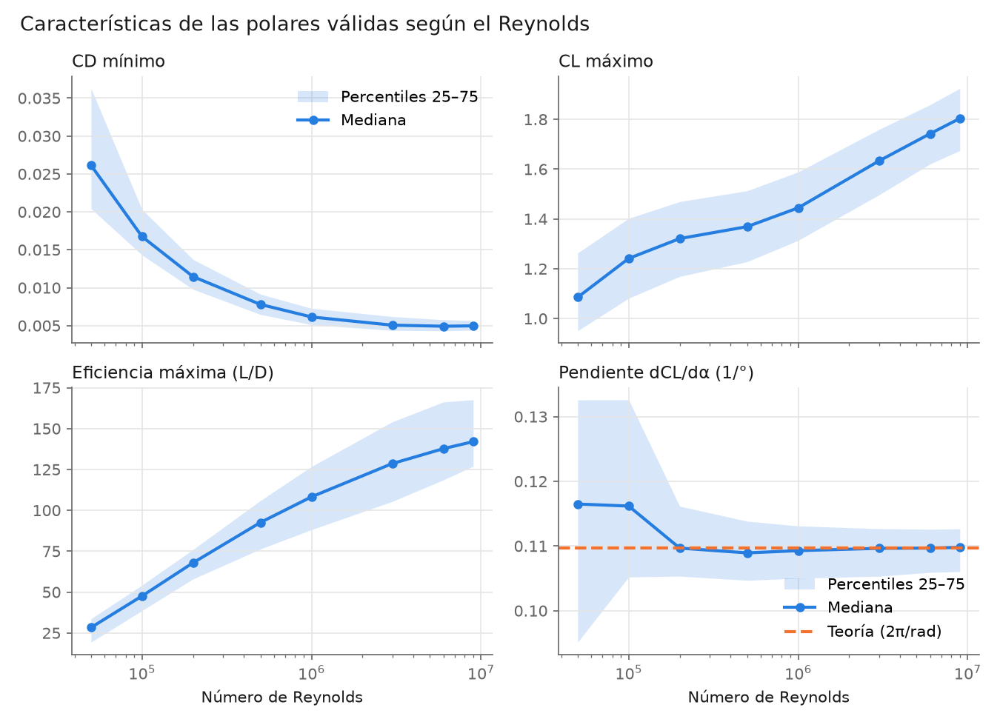
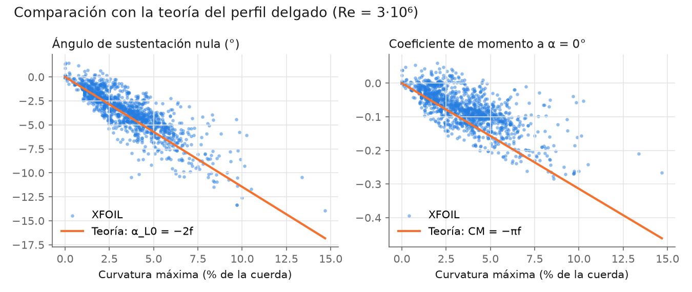

# Polares con XFOIL

Fase 2 del proyecto: cálculo automático del rendimiento aerodinámico (las **polares**: CL, CD y CM en función del ángulo de ataque) de los 1.656 perfiles limpios, a 8 números de Reynolds, con [XFOIL](https://web.mit.edu/drela/Public/web/xfoil/). Los resultados se guardan en la base de datos ([`base-datos.md`](base-datos.md)) y serán los datos de entrenamiento de la Fase 3.

## Resumen

| | Resultado |
|---|---|
| Polares calculadas | **13.248** (1.656 perfiles × 8 Reynolds) |
| Polares válidas | **10.802 (81,5 %)** |
| Puntos guardados | 562.555, de ellos 90.155 (16,0 %) después de la pérdida |
| Perfiles sin ninguna polar válida | 33 (2,0 %) |
| Tiempo de cálculo | 14,5 h |

| Elemento | Archivo |
|---|---|
| XFOIL desde Python | `src/xfoil.py` |
| Calidad de una polar | `src/polares.py` |
| Cálculo completo | `src/calcular_polares.py` |
| Validación, malla, piloto y experimentos | `src/validar_xfoil.py`, `src/convergencia_paneles.py`, `src/piloto_xfoil.py`, `src/analizar_piloto.py`, `src/error_interpolacion.py`, `src/probar_reintento.py` |
| Análisis del dataset | `src/analizar_polares.py` → `docs/figuras/` |
| Tablas | `sql/002_polares.sql`, `sql/003_reintento.sql` |

Todas las decisiones se tomaron **con datos medidos**: primero con perfiles conocidos (validación y malla), después con un piloto de 400 polares y con dos experimentos, y solo entonces se lanzó el cálculo completo.

## 1. Condiciones de cálculo

| Parámetro | Valor | Motivo |
|---|---|---|
| Reynolds | 5·10⁴, 10⁵, 2·10⁵, 5·10⁵, 10⁶, 3·10⁶, 6·10⁶, 9·10⁶ | Desde drones pequeños (≈ 2·10⁵) hasta el crucero de una avioneta (≈ 6·10⁶). Espaciados en escala logarítmica, porque los efectos viscosos varían con log(Re), y con más valores en Re bajos, donde aparecen las burbujas de separación laminar. 3, 6 y 9·10⁶ coinciden con los ensayos de *Theory of Wing Sections* (Abbott y von Doenhoff) |
| Ángulo de ataque | −5° a 20°, cada 0,5° (51 puntos) | El límite inicial de 15° no alcanzaba la pérdida en la validación (apartado 3) |
| Barridos | 0° → 20° y, tras reiniciar la capa límite (`INIT`), −0,5° → −5° | XFOIL arranca cada punto desde la solución del anterior: empezar en 0°, donde converge con facilidad, pierde menos puntos |
| Ncrit | 9 | Valor estándar (túnel de calidad media o aire limpio), comparable con la literatura |
| Mach | 0 | Régimen subsónico de baja velocidad |
| Paneles | 160 | Estudio de convergencia de malla (apartado 4) |
| Iteraciones | 100 por punto | Con las 20 por defecto, muchos puntos cerca de la pérdida no convergen |
| Tiempo máximo | 20 s por polar | La polar terminada más lenta del piloto tardó 10,5 s (apartado 5) |

Con estas condiciones, el alcance del proyecto pasa de "Re entre 5·10⁴ y 3·10⁶" a **"Re entre 5·10⁴ y 9·10⁶"**, para cubrir el crucero de la aviación ligera.

## 2. XFOIL desde Python

XFOIL es un programa interactivo sin API: solo lee comandos del teclado. `src/xfoil.py` lo controla así:

1. Crea una **carpeta temporal** y copia el perfil como `perfil.dat`. Así cada cálculo empieza limpio (XFOIL añade puntos a la polar si el archivo ya existe) y los nombres son cortos y sin espacios, que es lo que XFOIL tolera.
2. Lanza XFOIL con `subprocess.run` y le escribe todos los comandos de golpe (`input=`): desactivar los gráficos, cargar, mallar, Reynolds, Ncrit, iteraciones y barridos.
3. Lee el archivo de la polar y lo convierte en un DataFrame ordenado por α.

**Estados.** `ok` (ha terminado con puntos), `sin_convergencia` (ha terminado sin ningún punto) y `tiempo_agotado` (se ha colgado y se ha detenido el proceso).

**Recuperación de puntos.** XFOIL escribe cada punto en el archivo según converge. Si se cuelga, se leen los puntos que llegó a calcular. En el piloto, 17 de las 23 polares colgadas aportaron 30,6 puntos de media.

**Reintento de la zona lineal.** Si una polar no es válida (apartado 6) pero tiene puntos, se repite el cálculo solo entre −2° y 10,5°, con un paso de 0,25°, y sus puntos rellenan los huecos de la original (solo los múltiplos de 0,5°, para mantener la misma rejilla de ángulos). Ver apartado 6.3.

## 3. Validación

NACA 0012 y NACA 2412 a 3, 6 y 9·10⁶, comparados con la teoría del perfil delgado (`src/validar_xfoil.py`):

| | Teoría | NACA 0012 | NACA 2412 |
|---|---|---|---|
| Pendiente dCL/dα | 0,110/° (2π/rad) | 0,110–0,113/° | 0,111–0,112/° |
| Ángulo de sustentación nula | 0° y −2,08° | 0,00° | −2,22° a −2,24° |
| CM | 0 y −0,053 | 0,000 | −0,053 |

Los seis casos quedan dentro de tolerancia (±10 % en la pendiente, ±0,5° en α_L0 y ±0,015 en CM). En la zona lineal, XFOIL es muy fiable.

**Limitaciones conocidas de XFOIL**, que se confirmaron aquí:

- **CL máximo optimista.** Entre un 5 % y un 15 % más alto que en el túnel, y la pérdida llega 2–4° más tarde. El error crece con el Reynolds: a 6 y 9·10⁶, el NACA 0012 no entra en pérdida antes de 20°, mientras que en el túnel lo hace hacia los 16°. Es el mecanismo de pérdida por el borde de ataque, que el modelo de capa límite integral de XFOIL no captura.
- **CD mínimo ligeramente optimista.** XFOIL supone una superficie perfectamente lisa.

Estas limitaciones no se corrigen: se documentan. **El CL máximo es la magnitud menos fiable del dataset.**

## 4. Convergencia de malla

Para comprobar si más paneles mejoraban la predicción de la pérdida (`src/convergencia_paneles.py`):

| Caso | 120 → 160 paneles | 160 → 320 paneles |
|---|---|---|
| NACA 0012, Re = 6·10⁶ | Sin cambios relevantes | CD mín. +0,4 %, CL máx. −0,3 % |
| NACA 2412, Re = 3·10⁶ | Sin cambios relevantes | CD mín. +0,4 %, CL máx. −0,4 % |
| NACA 2412, Re = 10⁵ | Pendiente +5 % | Pendiente +0,2 %, CL máx. +2 %, **8 veces más lento** |

- A Reynolds altos, 160 paneles están convergidos, y el CL máximo sigue siendo optimista con 320: **el problema es del modelo, no de la malla**.
- A Reynolds bajos, 120 paneles se quedan cortos, y 320 mejoran solo un 2 % el CL máximo a cambio de un cálculo 8 veces más lento y más polares colgadas.
- **Decisión: 160 paneles.**

## 5. Piloto

400 polares (50 perfiles al azar, con semilla fija, × 8 Reynolds) para medir antes de lanzar el cálculo completo (`src/piloto_xfoil.py`, `src/analizar_piloto.py`):

| Hallazgo | Decisión |
|---|---|
| La polar terminada más lenta tardó 10,5 s (percentil 99: 6 s), pero las colgadas consumían 60 s cada una: más de la mitad del tiempo total | **Tiempo máximo de 20 s.** Las polares colgadas no son lentas: están bloqueadas. El piloto bajó de 36 a 22 minutos |
| Las polares colgadas se descartaban enteras | **Recuperar los puntos calculados** antes de colgarse |
| `fx61163.dat` falla a los 8 Reynolds, con una geometría correcta | **Sin tratamiento especial.** Los fallos se registran y se excluyen con una regla general, no con una lista de excepciones |
| Los puntos con CD > 0,2 están todos a α > 10°, casi todos después de la pérdida | **No se borran**: son físicamente posibles con el flujo separado. Se marcan (apartado 6.1) |
| Polares con muchos puntos perdidos, sobre todo a Reynolds bajos | Criterio de validez (apartado 6.2) |

## 6. Calidad de las polares

Ningún punto convergido se borra. La calidad se registra en dos niveles, y cada uso de los datos decide qué filtra.

### 6.1. Puntos: `post_perdida`

Cada punto con α mayor que el del CL máximo de su polar se marca como `post_perdida`. Es un criterio físico (lo que hay después de la pérdida, donde XFOIL es poco fiable) y no un umbral arbitrario de CD. El 77,8 % de los puntos con CD > 0,2 del piloto quedaban marcados así. El resto estaban sobre todo a Re = 5·10⁴, donde la capa límite laminar se separa sin volver a adherirse y el CL sigue subiendo lentamente sin un máximo claro.

### 6.2. Polares: `valida`

Una polar es válida si su **zona lineal** (−2° a 10°], la más importante para el diseño y donde XFOIL es fiable, está bien cubierta:

- **Cobertura ≥ 0,8**: han convergido al menos el 80 % de sus 24 ángulos.
- **Hueco ≤ 1°**: como mucho falta un punto aislado. El hueco se mide incluyendo los extremos de la zona.

**Cómo se eligió el hueco máximo** (`src/error_interpolacion.py`). En 151 polares del piloto con la zona lineal completa se quitaron puntos a propósito, se interpolaron y se compararon con el valor calculado por XFOIL:

| Hueco | Puntos que faltan | CL, p95 (Re ≤ 2·10⁵ / ≥ 5·10⁵) | CD, p95 (Re ≤ 2·10⁵ / ≥ 5·10⁵) |
|---|---|---|---|
| 1° | 1 | 0,027 / 0,009 | 4,8 % / 4,0 % |
| 1,5° | 2 | 0,042 / 0,013 | 7,4 % / 6,5 % |
| 2° | 3 | 0,053 / 0,017 | 10,3 % / 9,2 % |

Las medianas son muy pequeñas (CL < 0,002 con un hueco de 1°). Los errores grandes del percentil 95 vienen de los "codos" de las polares, cuando la transición salta de posición. Con un hueco de 1°, el error añadido es claramente menor que la propia incertidumbre de XFOIL frente al túnel (≈ 10 % en CD). Con 2°, es del mismo orden. La cobertura apenas influye (entre 0,7 y 0,8 hay menos de 2 puntos de diferencia en polares válidas), y se fija en 0,8 como protección frente a polares con muchos puntos sueltos perdidos.

**"No válida" no significa "inservible".** Los puntos de una polar no válida se guardan igual. La marca sirve para los usos que necesitan la curva entera (por ejemplo, la eficiencia máxima). Un modelo que aprenda punto a punto puede usarlos.

### 6.3. Reintento

En polares terminadas en 1–2 s aparecían huecos de 7–11° en plena zona lineal, mientras que el mismo perfil salía completo a otros Reynolds. La causa: cuando un punto no converge, XFOIL arranca el siguiente desde esa solución mala, y los fallos se encadenan. Un segundo barrido con un camino distinto (paso de 0,25°, solo en la zona lineal) lo rompe (`src/probar_reintento.py`):

| | Piloto |
|---|---|
| Polares reintentadas | 114 de 400 (28,5 %) |
| Recuperadas | 43 (37,7 %) |
| Coste | 3,0 s por reintento |
| Polares válidas | **69,5 % → 80,2 %** |

Recupera sobre todo a Reynolds intermedios y altos (65 % a 10⁶, 75 % a 6·10⁶), donde los huecos venían del encadenamiento. A Re = 5·10⁴ recupera el 15 %: allí los fallos son físicos (burbujas laminares que XFOIL no resuelve), no del camino del barrido. No se añadieron más estrategias: cada una recupera menos que la anterior.

## 7. Base de datos

```
perfiles (1.656)
   │ 1 perfil → 8 cálculos
   ▼
calculos (13.248)  ← una fila por perfil y Reynolds: estado, tiempo, calidad, valida y reintento
   │ 1 cálculo → hasta 51 puntos
   ▼
polares (562.555)  ← una fila por punto: α, CL, CD, CDp, CM, transición y post_perdida
```

- **Dos tablas.** `calculos` registra cómo fue cada cálculo, incluidos los que no dieron ningún punto. Si solo existiera `polares`, esos fallos desaparecerían sin dejar rastro.
- **Claves primarias** `(archivo, reynolds)` y `(archivo, reynolds, alpha)`. La primera permite reanudar el cálculo: lo que ya está en `calculos` no se vuelve a calcular.
- **`reynolds` como `INTEGER`.** Forma parte de las claves, y los números decimales como clave son frágiles.
- **Claves foráneas en cadena** (perfiles → calculos → polares) con `ON DELETE CASCADE`, y un `CHECK` que solo admite los tres estados posibles.
- **Migraciones.** `sql/002_polares.sql` crea las tablas y `sql/003_reintento.sql` añade la columna `reintento`. El esquema original se renombró a `sql/001_esquema.sql` para que PostgreSQL ejecute los archivos en orden. Ver [`base-datos.md`](base-datos.md).
- **`cargar_bd.py` ya no vacía `perfiles`**, porque el vaciado en cascada borraría los resultados de XFOIL.

**El cálculo completo** (`src/calcular_polares.py`) guarda cada polar en una transacción nada más calcularla, con su fila de `calculos` y sus puntos, y se salta las ya guardadas. Si se interrumpe (`Ctrl+C`, un corte de luz…), basta con volver a lanzarlo.

## 8. Resultados del cálculo completo

| Reynolds | Válidas | % | Reintentadas | Colgadas | Sin puntos |
|---|---|---|---|---|---|
| 5·10⁴ | 1.282 | 77,4 | 499 | 26 | 18 |
| 10⁵ | 1.256 | 75,8 | 545 | 82 | 17 |
| 2·10⁵ | 1.312 | 79,2 | 517 | 141 | 21 |
| 5·10⁵ | 1.361 | 82,2 | 474 | 151 | 33 |
| 10⁶ | 1.350 | 81,5 | 423 | 126 | 48 |
| 3·10⁶ | 1.427 | 86,2 | 324 | 54 | 35 |
| 6·10⁶ | 1.421 | 85,8 | 318 | 28 | 32 |
| 9·10⁶ | 1.393 | 84,1 | 356 | 29 | 36 |
| **Total** | **10.802** | **81,5** | **3.456** | **637** | **240** |

Los porcentajes coinciden con los del piloto (80,2 % de válidas, ≈ 5 % de colgadas), lo que confirma que la muestra era representativa. El 36,2 % de las polares reintentadas acabaron siendo válidas.

- **Las válidas aumentan con el Reynolds**: a Reynolds bajos, las burbujas de separación laminar dificultan la convergencia.
- **Las colgadas se concentran entre 2·10⁵ y 10⁶**, el régimen en el que la burbuja laminar y la transición interactúan.

## 9. Análisis del dataset

`src/analizar_polares.py` calcula las características de las 10.802 polares válidas y comprueba que tienen sentido físico.



| Reynolds | CD mínimo | CL máximo | L/D máxima | dCL/dα (1/°) |
|---|---|---|---|---|
| 5·10⁴ | 0,0261 | 1,09 | 28 | 0,117 |
| 10⁵ | 0,0167 | 1,24 | 48 | 0,116 |
| 2·10⁵ | 0,0115 | 1,32 | 68 | 0,110 |
| 5·10⁵ | 0,0078 | 1,37 | 93 | 0,109 |
| 10⁶ | 0,0061 | 1,44 | 108 | 0,109 |
| 3·10⁶ | 0,0051 | 1,63 | 129 | 0,110 |
| 6·10⁶ | 0,0049 | 1,74 | 138 | 0,110 |
| 9·10⁶ | 0,0050 | 1,80 | 142 | 0,110 |

*Medianas de las polares válidas. La eficiencia máxima se calcula con los puntos anteriores a la pérdida.*

- **El CD mínimo baja** con el Reynolds, porque la capa límite es relativamente más delgada, y se estabiliza a partir de 3·10⁶, donde el adelanto de la transición compensa la menor fricción (como en la validación).
- **El CL máximo sube**, porque la capa límite aguanta mejor el gradiente adverso. Teniendo en cuenta el apartado 3, sus valores son optimistas, sobre todo a Reynolds altos. El 16,3 % de las polares válidas tiene el CL máximo en 20°.
- **La eficiencia máxima se multiplica por 5** entre 5·10⁴ y 9·10⁶. Es el motivo de que los aviones grandes sean mucho más eficientes que los drones pequeños.
- **La pendiente coincide con 2π/rad** a partir de 2·10⁵. A 5·10⁴ y 10⁵ es mayor (0,116/°) y mucho más dispersa: la burbuja laminar cambia de posición con el ángulo de ataque y modifica la forma efectiva del perfil, un efecto conocido en perfiles de baja velocidad.



Comparación con la teoría del perfil delgado a Re = 3·10⁶ (1.427 polares):

| | XFOIL | Teoría (línea media parabólica) |
|---|---|---|
| dα_L0/df | −1,75 rad | −2,00 rad |
| dCM/df | −2,11 | −π = −3,14 |
| Perfiles simétricos | α_L0 = 0,01°, CM = 0,0000 | 0 y 0 |

- **El ángulo de sustentación nula sigue la teoría.** La pendiente es algo menor porque la mayoría de perfiles reales tienen la curvatura máxima por delante del 50 % de la cuerda que supone la línea media parabólica (el NACA 2412 daría −1,82 rad).
- **El CM se aleja más de la recta y está muy disperso.** El momento depende mucho más de *dónde* está la curvatura que de su valor máximo: la curvatura cerca del borde de salida da CM muy negativos, y los perfiles *reflex* (con la línea media hacia abajo cerca del borde de salida, típicos de alas volantes) dan CM cercanos a cero o positivos aunque tengan curvatura. La curvatura máxima sola no basta para predecirlo. No es un error de los datos: los perfiles simétricos dan CM = 0 exactamente.

### Perfiles sin ninguna polar válida

33 perfiles (2,0 %) no tienen ninguna polar válida y quedan fuera de los usos que necesitan polares válidas:

| | Fallidos | Todos |
|---|---|---|
| Espesor máximo (mediana) | 9,4 % | 11,9 % |
| Curvatura máxima (mediana) | 3,8 % | 3,1 % |

Son más **finos y curvados** que la media. La validez cae claramente en los perfiles finos:

| Espesor máximo | ≤ 6 % | 6–9 % | 9–12 % | 12–15 % | 15–18 % | > 18 % |
|---|---|---|---|---|---|---|
| Polares válidas | 48,1 % | 74,1 % | 87,4 % | 86,2 % | 85,7 % | 81,6 % |

En perfiles finos, el borde de ataque es muy afilado y aparecen burbujas de separación que XFOIL resuelve mal. Entre los 33 hay perfiles históricos finos y muy curvados (`eiffel10`, `m19`, `m22`, `m25`), Wortmann de alta sustentación (`fx61163`, `fx63147`, `fx74cl5140`…) y dos supercríticos (`sc20402`, `sc20503`), diseñados para el régimen transónico.

Lista completa: bw050209, dsma523a, e340, e341, e49, e818, e850, eiffel10, fx3, fx61163, fx62k131, fx62k153, fx63147, fx69274, fx74cl5140, fx79w470a, goe09k, goe445, goe451, hq09, kenmar, la203a, lrn1007, m19, m22, m25, marsden, mh150, sc20402, sc20503, strand, ys915, ys920.

## 10. Uso

Requisitos: XFOIL instalado y su ruta en `.env` (`XFOIL_PATH`, ver `.env.example`), y la base de datos levantada con el catálogo cargado.

```bash
python src/validar_xfoil.py          # validación con los NACA 0012 y 2412 (≈ 1 min)
python src/calcular_polares.py 3     # prueba con 3 perfiles
python src/calcular_polares.py       # cálculo completo (≈ 15 h, reanudable)
python src/analizar_polares.py       # análisis y figuras en docs/figuras/
```

En una base de datos creada antes de la Fase 2, las migraciones se aplican una sola vez:

```bash
docker compose exec -T db psql -U airfoil -d airfoil < sql/002_polares.sql
docker compose exec -T db psql -U airfoil -d airfoil < sql/003_reintento.sql
```

## 11. Limitaciones y pasos futuros

- **CL máximo y pérdida optimistas**, sobre todo a Reynolds altos (apartado 3). Los puntos después de la pérdida están marcados y conviene tratarlos con cuidado.
- **Re = 5·10⁴ es el límite inferior de fiabilidad de XFOIL.** La separación laminar sin readherencia hace que algunas polares no tengan un CL máximo claro.
- **Condiciones fijas**: Ncrit = 9, Mach 0 y transición libre. Otras condiciones (por ejemplo, transición forzada para simular rugosidad) necesitarían otro cálculo.
- **Ejecución en Windows y en secuencial.** XFOIL se ejecuta fuera de Docker y de una polar en una. Para la Fase 4, que validará con XFOIL los perfiles diseñados desde la API, hará falta XFOIL dentro de un contenedor.
